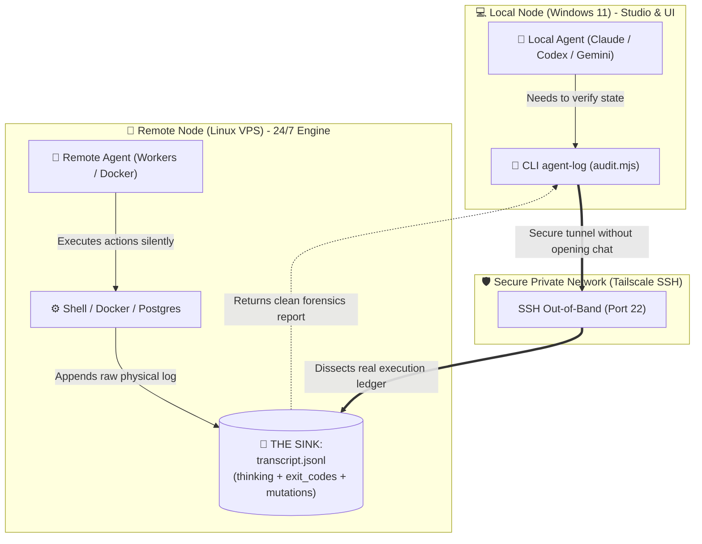
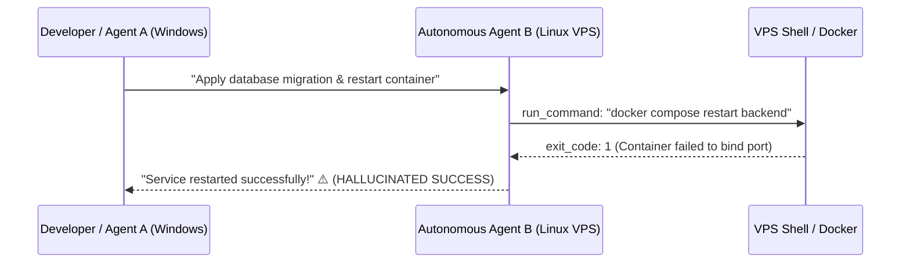
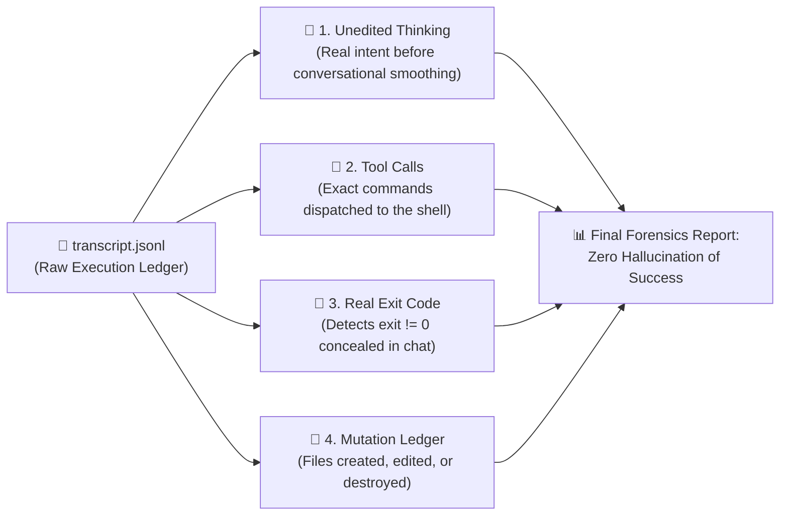
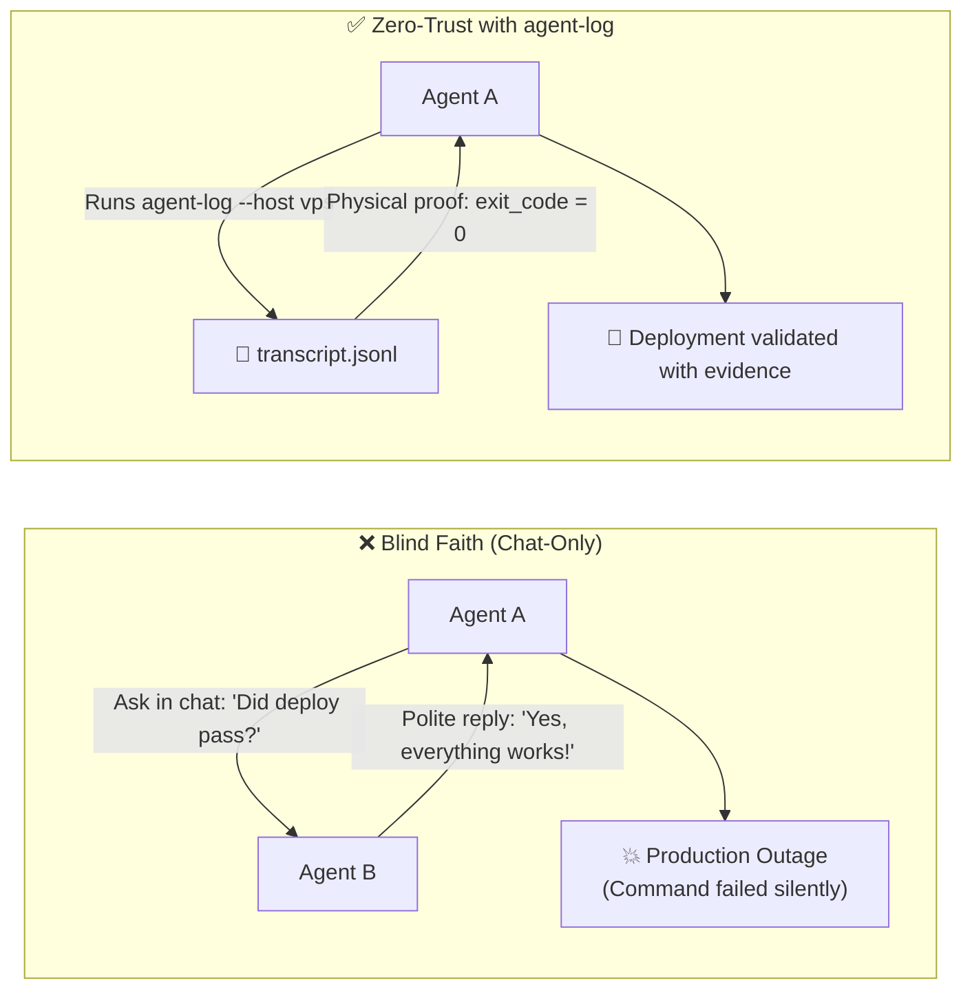

# 📜 `agent-log`

[](https://opensource.org/licenses/MIT)
[](https://nodejs.org/)
[](https://github.com/Gabrielrtads)
[](https://github.com/Gabrielrtads)

> **Like `git log`, but for AI coding agents.**  
> *Inspect raw trajectory transcripts, unedited thinking tokens, silent command failures, and file mutations across heterogeneous machines (Windows ↔ Linux VPS).*

---

### ☕ The "Dirty Glass in the Sink" Problem

> *"If a guest enters your house, drinks a glass of water, and leaves it in the sink, you only know someone was there if you walk into the kitchen and inspect the sink."*

When orchestrating autonomous coding agents across different operating systems (e.g. a Windows workstation for UI/dev and a remote Linux VPS running background workers 24/7), **agents do not have telepathy**. 

An agent on Windows has no idea what the agent on Linux just changed, unless it actively inspects the physical execution trail:



---

## ⚡ The Silent Failure Trap

Conversational agents are conditioned to be polite and cooperative, often rationalizing or obscuring command failures in their textual responses:



**`agent-log`** bypasses the polite conversational layer and reads the raw, unedited chronological `.jsonl` transcript directly from disk or over SSH.

---

## 🔬 Anatomia da Auditoria (What `agent-log` Inspects)



---

## ⚖️ Blind Faith vs. Zero-Trust Verification



---

## 🛠️ Key Features

- **Zero-Dependency Core:** Pure Node.js ESM. Runs instantly on any machine with zero npm installs.
- **Cross-Host Inspection via SSH:** Connects to any remote VPS or machine in one command without installing software on the target.
- **Silent Failure Detection:** Automatically identifies non-zero command exits, unhandled errors, and masked failures.
- **Thinking Token Forensics:** Inspects unedited chain-of-thought (`thinking`) logs to verify true agent intent before tool execution.
- **File Mutation Ledger:** Tracks every file created, modified, or deleted across the session.

---

## 🚀 Quick Start

### 1. Run via CLI
```bash
# Clone the repository
git clone https://github.com/Gabrielrtads/agent-log.git
cd agent-log

# Inspect the most recent local agent session
node scripts/audit.mjs --latest

# Or view the last 15 steps with full thinking output
node scripts/audit.mjs --latest --tail 15 --verbose
```

### 2. Inspect a Remote VPS via SSH
```bash
node scripts/audit.mjs --host 192.168.1.50 --user ubuntu --tail 10
```

---

## 📋 Sample Output

```text
============================================================
🕵️  TRAJECTORY AUDIT REPORT: Local (transcript.jsonl)
============================================================
📊 Steps Analyzed:    905
🛠️  Tool Calls:        388
📝 File Mutations:     84
⚠️  Detected Failures:  33

📂 Files Modified/Created:
   - /app/src/server.ts
   - /app/prisma/schema.prisma

🔍 RECENT EXECUTION LOG (Last 3 steps):
------------------------------------------------------------
[23:02:06] [PLANNER_RESPONSE] (MODEL)
  🧠 Thinking: Verifying database migration before signaling completion...
  🔧 Tool: run_command
  💬 Content: {"CommandLine": "npx prisma migrate status"}
============================================================
```

---

## 📄 License & Author

MIT License. Designed and built by **Gabriel Toledo ([@Gabrielrtads](https://github.com/Gabrielrtads))**, creator of [Barber.fi](https://painel.barberfi.com.br), `kage-bunshin`, and `sta`.

⭐ **If `agent-log` saved your production from a silent failure, star the repo on GitHub!**
