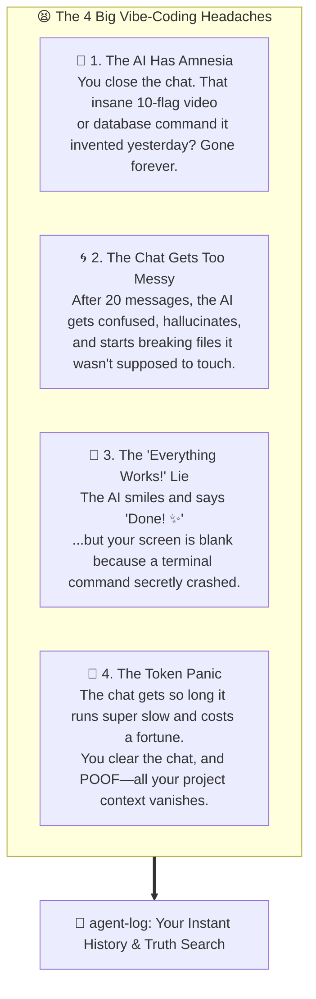
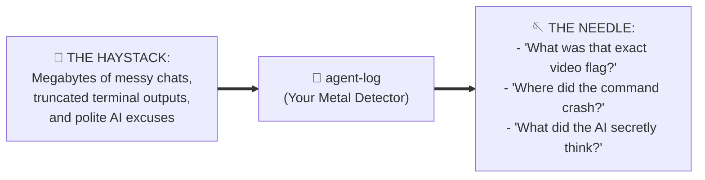
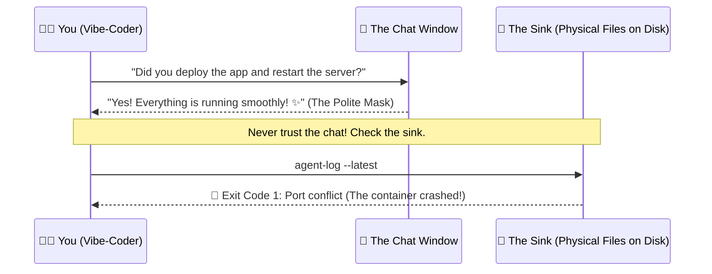

# 📜 agent-log

> **The Time Machine & Lie Detector for Vibe-Coders.**  
> *(Find that one magical command from 3 days ago, untangle messy chats, and catch your AI when it pretends everything worked).*

[](#)
[](https://skills.sh)
[](#)
[-gold?style=for-the-badge)](#)
[](#)
[](https://github.com/Gabrielrtads/agent-log/stargazers)

```bash
# ⚡ 1-Click Install in your terminal:
npx skills add Gabrielrtads/agent-log

# Or run instantly:
npx agent-log --latest
```

---

## 😫 If You Vibe-Code With AI, You Know These 4 Nightmares:

When you're building apps with AI agents (Claude Code, Cursor, Codex, Antigravity, Windsurf), things feel like magic—until one of these happens:



---

## 🧲 Analogy #1: The Needle in the Haystack (The Metal Detector)

> *"Your past AI chats are a giant haystack of messy text. What you actually need is the needle: that one magical command that worked. **`agent-log` is your metal detector.**"*



Instead of scrolling through 400 lines of old chat history by hand, you wave `agent-log` over your computer. In under 1 second, it beeps exactly where your needle is.

---

## 🥛 Analogy #2: The Dirty Glass in the Sink (Physical Proof)

> *"If a guest enters your house, drinks a glass of water, and leaves it in the sink, you don't ask them if they were thirsty. You just look at the sink."*



When vibe-coding, **never ask the AI in the chat if it worked**. It is trained to be polite and agreeable, so it will often say *"Done! ✨"* even when a terminal command silently blew up.

`agent-log` doesn't ask the AI. It walks straight into the kitchen, inspects the sink (`transcript.jsonl`), and shows you the raw physical proof: what ran, what failed, and what actually changed.

---

## 💡 What Can You Do With It? (6 Simple Superpowers)

### 🔍 1. Find That "One Magical Command" from 3 Days Ago
Stop trying to make the AI guess the command again. Just search for a word you remember:
```bash
agent-log --search "ffmpeg" --all
```
Boom! In 1 second, it pulls up the exact command that worked yesterday.

### 🤥 2. The AI Lie Detector (Catch Hidden Errors)
Did the AI say *"Everything is done"* but your code still doesn't run?
```bash
agent-log --latest
```
It instantly shows you if any command secretly failed behind the scenes with a red exit error.

### 🧠 3. Read the AI's "Secret Thoughts" (Unfiltered Thinking)
Did the AI actually know what it was doing, or was it totally guessing?
```bash
agent-log --latest --verbose
```
This shows you the AI's raw `thinking` stream—what it thought to itself *before* typing its friendly answer to you.

### 📁 4. "What Files Did the AI Actually Touch?"
Before running your project, see the exact checklist of files created or modified in the last session:
```bash
agent-log --latest
```
No more guessing if the AI edited your `.env` or changed a config file without telling you.

### 💰 5. Search Past Chats for $0 (Zero Token Cost)
Instead of copying 200 lines of error logs into your chat (which costs money and clogs the AI's memory), `agent-log` searches everything directly on your hard drive. **Fast, offline, and 100% free.**

### 🌐 6. Peek Into What Your Remote Server Did
Have an AI agent running on a cloud VPS or another computer? Check what it did without opening SSH manually:
```bash
agent-log --host 100.98.233.126 --tail 10
```

---

## 🎮 Easy Cheat Sheet (Copy & Paste)

| What You Want to Do | Command to Run |
|---|---|
| **"What did the AI just do?"** | `agent-log --latest` |
| **"Find that command with keyword 'prisma'"** | `agent-log --search "prisma"` |
| **"Search across ALL past AI sessions"** | `agent-log --search "docker" --all` |
| **"Show me the last 15 actions with full details"** | `agent-log --latest --tail 15 --verbose` |
| **"Check what happened on my remote VPS"** | `agent-log --host <ip-address>` |

---

## 🚀 How It Works (In Plain English)

Every time an AI coding tool (like Claude Code, Cursor, Codex, or Antigravity) does something on your computer, it quietly writes a journal file in your system folder (`transcript.jsonl`).

Most people never look at these files because they are gigantic walls of scary-looking code.

**`agent-log` is just a friendly metal detector that reads those journals for you in half a second**, pulls out the juicy parts (what files changed, what commands ran, what broke), and shows them cleanly on your screen.

---

<div align="center">

### ⭐ Did this save you from a vibe-coding headache?
If `agent-log` helped you find a lost command or caught an AI bug, give it a star on GitHub! It helps more vibe-coders discover the tool.

[](https://github.com/Gabrielrtads/agent-log/stargazers)

---

**Made with ❤️ for the Vibe-Coding Community by [Gabriel Toledo (@Gabrielrtads)](https://github.com/Gabrielrtads)**  
*Creator of [Barber.fi](https://painel.barberfi.com.br), `vibe-design-studio`, `kage-bunshin`, and `sta`.*

MIT Licensed — 100% Free & Open Source.

</div>
