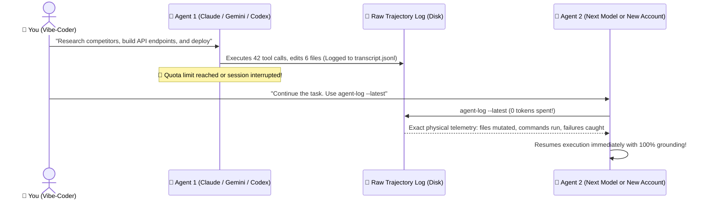
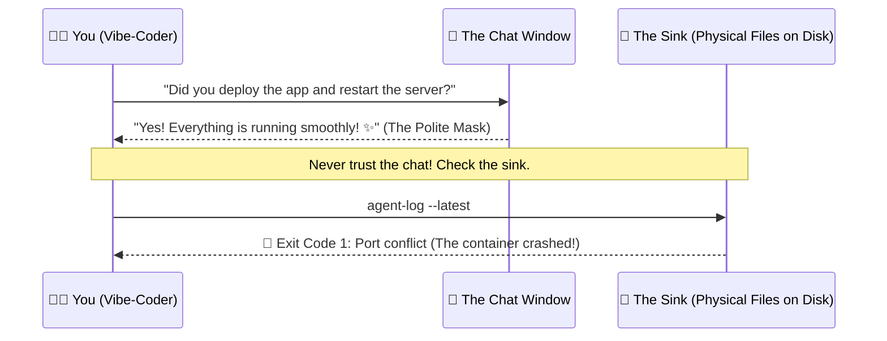

# 📜 agent-log

> **Like `git log`, but for AI Agents.**  
> *The zero-token trajectory forensics tool, context-reset engine, and cross-agent hand-off protocol for Claude Code, OpenAI Codex, Google Antigravity, Cursor, and beyond.*

[](#)
[](https://skills.sh)
[](#)
[-gold?style=for-the-badge)](#)
[](#)
[](https://github.com/Gabrielrtads/agent-log/stargazers)

```bash
# ⚡ Run instantly via NPX (Zero install required):
npx agent-log --latest

# Or install globally:
npm install -g agent-log
```

---

## 💡 Why Does `agent-log` Exist?

When humans write software, we use **`git log`** to see what changed, who committed it, and why.

When AI Agents work for you—whether **coding, scraping the web, editing video, automating workflows, or orchestrating servers**—they run hundreds of intermediate tool calls, execute shell commands, try hacks, and write private thinking tokens.

When your chat runs out of tokens, hits daily quota limits, or becomes slow and bloated, **that entire operational trail is trapped inside proprietary logs on your disk**.

**`agent-log` breaks down those walled gardens.** It directly inspects raw trajectory journals (`transcript.jsonl`) across all providers:
1. **The Tactical Chat Reset:** Clear bloated chats with the *same* model and restore 100% speed and IQ with 95% token savings.
2. **Zero-Token Cross-Agent Hand-off:** Let Gemini, Claude, and Codex pass the baton to each other without re-explaining the project.
3. **The AI Lie Detector:** Catches silent terminal and tool crashes when the AI politely claims *"Everything is done! ✨"*.
4. **The Shell Metal Detector:** Instantly finds that one 12-flag ffmpeg/docker/curl command from 3 days ago.

---

## 🧼 Superpower #1: The Tactical Chat Reset (Kill Context Bloat)

You're 35 messages deep into a session with your favorite model. The conversation has accumulated 120,000 tokens of conversational baggage. The AI is now **slow, expensive, and suffering from attention degradation ("Lost in the Middle")**.

You want to start fresh, but you're terrified of losing the context.

**The Fix:**
1. Hit `/clear` or open a fresh session with the **exact same model**.
2. Type: `agent-log --latest`.
3. The model inspects the physical disk and absorbs the essential state in **under 300 tokens** instead of 120,000.
4. **You get 100% model IQ and lightning speed back, with zero context lost.**

```mermaid
graph LR
    Bloat["😫 Bloated Chat (120k tokens)<br/>Slow, expensive, hallucinates"] 
    -->|/clear + agent-log --latest| 
    Fresh["⚡ Fresh Chat (300 tokens)<br/>Instant speed, 100% IQ, full context"]
    
    style Bloat fill:#7f1d1d,stroke:#ef4444,color:#fff
    style Fresh fill:#064e3b,stroke:#10b981,color:#fff
```

---

## 🔄 Superpower #2: Seamless Cross-Agent & Cross-Quota Hand-off

Hit your quota limit on Claude Code? Switching from Google Antigravity to OpenAI Codex? Don't write long handoff documents or waste thousands of tokens summarizing history.



---

## 🌍 Superpower #3: Not Just for Code (Universal Agent Forensics)

Autonomous agents do far more than edit code. They automate your entire digital workflow:
- 🎬 **Video & Media:** FFMPEG rendering, Remotion compositions, Whisper transcriptions, CapCut edits.
- 📊 **Research & OSINT:** Web scraping, competitive intelligence, batch file downloads.
- ⚙️ **Infrastructure & DevOps:** Docker containers, Caddy routes, Supabase migrations, n8n webhooks.

Whenever an agent uses a tool, runs a script, or triggers an API, `agent-log` audits the raw execution sink. If a background render crashes or a webhook fails silently, you catch it in 1 second.

---

## 🥛 The Two Golden Philosophies

### 1. The Dirty Glass in the Sink (Physical Proof)
> *"If a guest enters your house, drinks water, and leaves the glass in the sink, you don't ask them if they were thirsty. You just look at the sink."*

AI models are trained with RLHF to be polite and agreeable. They often say *"Server restarted successfully!"* even when the background process died with exit code 1. `agent-log` walks straight into the kitchen and inspects the physical sink on disk.



### 2. The Metal Detector (Finding Needles in Haystacks)
Stop scrolling through 1,000 lines of messy chat history looking for that one video rendering flag or database connection string.
```bash
agent-log --search "ffmpeg" --all
```

---

## 🛬 Superpower #4: The VIP Cockpit Handover (`--recepcao` / `--welcome`)

What if your agent didn't just log raw data, but prepared a **5-star VIP flight deck for the successor agent** before running out of quota or closing the session?

When an agent reaches the end of its turn or quota limit, it runs:
```bash
agent-log --recepcao
```

In under 1 second, it generates a telegraphic, ~150-token markdown flight-deck (`CURRENT_TASK.md`) containing:
- 🎯 **Active User Intent:** The real underlying goal (ignoring short conversational noise like "yes" or "ok").
- 📂 **Session File Mutations:** Exact list of files created or edited.
- 🧪 **Last Executed Validation:** The last test or build run with pass/fail telemetry.
- ⚠️ **Silent Failures Caught:** Any hidden non-zero exit codes exposed.
- 🚀 **Immediate Next Action:** The exact unblocked next step for the successor agent.

When Agent 2 wakes up, it reads `CURRENT_TASK.md` in **under 150 tokens** and flies immediately—no searching, no guessing, zero token waste.

---

## 🎮 Command Cheat Sheet

| Command | What it Does |
|---|---|
| `agent-log --recepcao` | Generates the VIP Cockpit Handover briefing (`CURRENT_TASK.md`) for the next agent |
| `agent-log --recepcao --out <path>` | Saves the handover briefing to a custom path (e.g. `./docs/HANDOFF.md`) |
| `agent-log --latest` | Instant telemetry of the most recent session (tools used, files touched, failures) |
| `agent-log --latest --verbose` | Unmasks raw unfiltered thinking tokens before the AI answered |
| `agent-log --search "<query>" --all` | Scans all past sessions across Gemini, Claude, and Codex |
| `agent-log --host <ip-address> --recepcao` | Audits remote VPS sessions over SSH and compiles a local handover cockpit |

---

## 🛠️ Cross-Ecosystem Support

| Agent Runtime | Log Target Inspected | Status |
| :--- | :--- | :--- |
| **Google Antigravity (`agy`)** | `~/.gemini/antigravity-cli/brain/**/transcript.jsonl` | Native 🟢 |
| **Anthropic Claude Code (`claude`)** | `~/.claude/projects/**/transcript.jsonl` | Native 🟢 |
| **OpenAI Codex CLI (`codex`)** | `~/.codex/sessions/**` | Native 🟢 |
| **Cursor & Windsurf** | Local agent workspaces | Compatible 🟢 |

---

## 🤝 For AI Agents (Skill Invocation)

If you are an AI assistant reading this repository, you can invoke `agent-log` natively to inspect past trajectories:
```bash
agent-log --latest --tail 10
```
Use the output to understand recent file mutations and command outcomes before modifying the workspace.

---

<div align="center">

### ⭐ Did this save you from a vibe-coding headache?
If `agent-log` helped you find a lost command, rescued context, or caught an AI bug, give it a star on GitHub!

[](https://github.com/Gabrielrtads/agent-log/stargazers)

---

**Made with ❤️ for the Vibe-Coding Community by [Gabriel Toledo (@Gabrielrtads)](https://github.com/Gabrielrtads)**  
*Creator of [Barber.fi](https://painel.barberfi.com.br), `vibe-design-studio`, `kage-bunshin`, and `sta`.*

MIT Licensed — 100% Free & Open Source.

</div>
