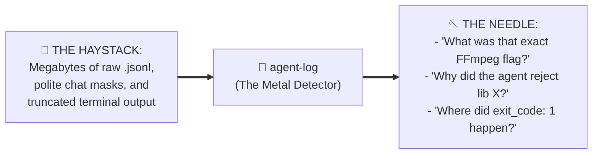
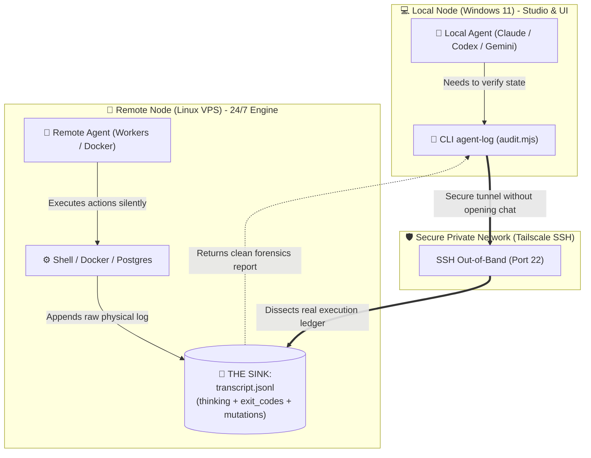
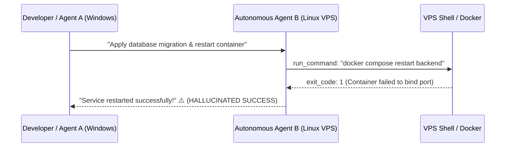
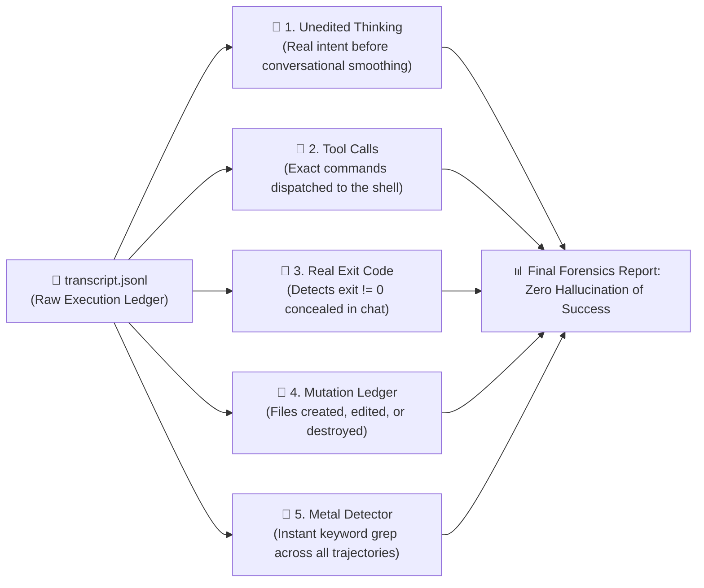

# 📜 `agent-log`

[](https://opensource.org/licenses/MIT)
[](https://nodejs.org/)
[](https://github.com/Gabrielrtads)
[](https://github.com/Gabrielrtads)

> **Like `git log` + a Metal Detector, but for AI coding agents.**  
> *Find the needles hidden inside gigabytes of agent logs, inspect unedited thinking tokens, expose silent command failures, and audit trajectories across heterogeneous machines (Windows ↔ Linux VPS) and competing AI harnesses (Google, Anthropic, OpenAI).*

---

## 🧲 The "Needle in the Haystack" Problem

> *"Your AI agents generate gigabytes of log hay. What you actually need is the needle — a specific command, an unhandled error, or an architectural decision made 3 days ago. **`agent-log` is your metal detector** across every CLI and session."*



When building software with autonomous agents in the terminal, you quickly hit two brick walls:

1. **For 1 Single Agent:**  
   The terminal clears, the chat window closes, and conversational amnesia strikes. Even worse: conversational LLMs are trained to be polite and will often say *"Setup completed successfully!"* while silently concealing that a background bash command crashed with `exit code 1`.
2. **Between Agents from Different Companies (Multi-Vendor):**  
   Google Antigravity/Gemini (`~/.gemini/`), Anthropic Claude Code (`~/.claude/`), and OpenAI Codex (`~/.codex/`) **do not have telepathy**. They store disparate sessions in isolated folders and cannot see what another agent touched on a remote Linux VPS.

**`agent-log`** serves as the universal forensic scanner and search engine across all of them.

---

### ☕ The "Dirty Glass in the Sink" Paradigm

> *"If a guest enters your house, drinks a glass of water, and leaves it in the sink, you only know someone was there if you walk into the kitchen and inspect the sink."*

When orchestrating autonomous coding agents across different operating systems (e.g. a Windows workstation for UI/dev and a remote Linux VPS running background workers 24/7), **`agent-log`** inspects the physical execution trail left in the sink:



---

## ⚡ The Silent Failure Trap

Conversational agents are conditioned to be polite and cooperative, often rationalizing or obscuring command failures in their textual responses:



**`agent-log`** bypasses the polite conversational layer and reads the raw, unedited chronological `.jsonl` transcript directly from disk or over SSH.

---

## 🔬 Anatomia da Auditoria (What `agent-log` Inspects)



---

## 🛠️ Key Features

- **🧲 Metal Detector Mode (`--search` / `--grep`):** Scan across unedited thinking, tool arguments, and output for specific terms or decisions.
- **Zero-Dependency Core:** Pure Node.js ESM. Runs instantly on any machine with zero npm installs.
- **Cross-Vendor Compatibility:** Audits Google Antigravity, Claude Code, and OpenAI Codex session histories.
- **Cross-Host Inspection via SSH:** Connects to any remote VPS or machine in one command without installing software on the target.
- **Silent Failure Detection:** Automatically identifies non-zero command exits, unhandled errors, and masked failures.
- **Thinking Token Forensics:** Inspects unedited chain-of-thought (`thinking`) logs to verify true agent intent before tool execution.
- **File Mutation Ledger:** Tracks every file created, modified, or deleted across the session.

---

## 🚀 Quick Start

### 1. The Metal Detector (Search Across Sessions)
Find needles in the log hay without reading megabytes of JSON:
```bash
# Search for a term in the most recent session
node scripts/audit.mjs --search "prisma migrate"

# Search across ALL known agent workspaces (Gemini, Claude, Codex)
node scripts/audit.mjs --search "ffmpeg" --all
```

### 2. Inspect Trajectory & Failures
```bash
# Inspect the most recent local agent session
node scripts/audit.mjs --latest

# Or view the last 15 steps with full thinking output
node scripts/audit.mjs --latest --tail 15 --verbose
```

### 3. Inspect a Remote VPS via SSH
```bash
node scripts/audit.mjs --host 100.98.233.126 --user ubuntu --tail 10
```

---

## 📋 Sample Metal Detector Output

```text
============================================================
🧲 METAL DETECTOR: Searching for "CapCut" in Trajectories
============================================================

📍 Session: ~/.gemini/antigravity/brain/.../transcript.jsonl
   Matches Found: 4
   --------------------------------------------------------
   ⏱️  Step #85 [13:24:20] (MODEL)
      * [thinking]: "...MCP rea can assist with analyzing CapCut app..."
      * [tool:run_command]: "{\"CommandLine\": \"Get-ChildItem AppData/Local/CapCut\"}"

============================================================
🎯 Summary: 4 needle(s) found across 1 transcript(s).
============================================================
```

---

## 📄 License & Author

MIT License. Designed and built by **Gabriel Toledo ([@Gabrielrtads](https://github.com/Gabrielrtads))**, creator of [Barber.fi](https://painel.barberfi.com.br), `vibe-design-studio`, `kage-bunshin`, and `sta`.

⭐ **If `agent-log` saved your production from a silent failure or helped you find a needle in the log hay, star the repo on GitHub!**
