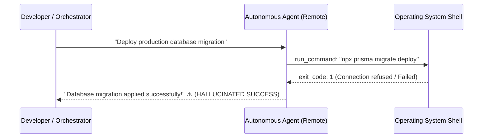
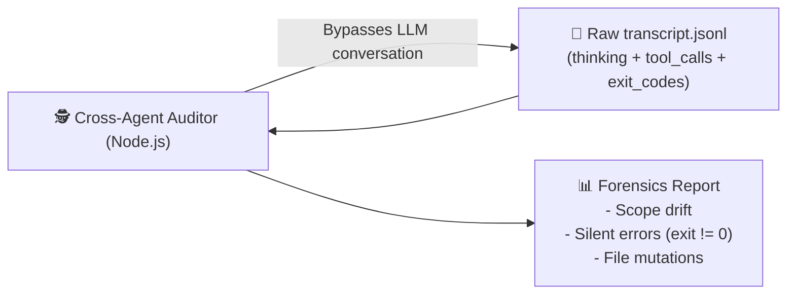

# 🕵️ Cross-Agent Trajectory Auditor (`cross-agent-trajectory`)

[](https://opensource.org/licenses/MIT)
[](https://nodejs.org/)
[](https://github.com/Gabrielrtads)
[](https://github.com/Gabrielrtads)

> **Multi-host, out-of-band forensics & trajectory inspection engine for autonomous AI coding agents.**  
> *Never trust an agent's self-reported success. Audit raw chronological execution logs (`transcript.jsonl`) across machines to catch silent failures, hallucinated tool outputs, and unauthorized file mutations.*

---

## ⚡ The Core Problem: The Silent Failure Trap

In production environments running distributed autonomous agents (e.g. Local Development ↔ Cloud VPS ↔ Edge Worker), conversational verification is brittle:



Conversational agents are conditioned to be polite and cooperative, often rationalizing or obscuring command failures in their textual responses.

### 🛡️ The Solution: Out-of-Band Trajectory Forensics

**Cross-Agent Trajectory Auditor** inspects raw chronological `.jsonl` execution ledgers directly over SSH or local disk:



---

## 🛠️ Key Features

- **Zero-Dependency Core:** Pure Node.js ESM. Runs instantly on any machine with zero npm installs.
- **Cross-Host Inspection via SSH:** Audit a cloud VPS or remote agent node in one command without installing software on the target.
- **Silent Failure Detection:** Automatically identifies non-zero command exits, unhandled errors, and masked failures.
- **Thinking Token Forensics:** Inspects unedited chain-of-thought (`thinking`) logs to verify true agent intent before tool execution.
- **File Mutation Ledger:** Tracks every file created or modified across the entire agent lifecycle.

---

## 🚀 Quick Start

### 1. Run via npx / CLI
```bash
# Clone the repository
git clone https://github.com/Gabrielrtads/cross-agent-trajectory.git
cd cross-agent-trajectory

# Audit the most recent local agent trajectory
node scripts/audit.mjs --latest

# Or inspect the last 20 steps with full thinking output
node scripts/audit.mjs --latest --tail 20 --verbose
```

### 2. Audit a Remote Machine via SSH
```bash
node scripts/audit.mjs --host 192.168.1.50 --user ubuntu --tail 15
```

---

## 📋 Sample Audit Output

```text
============================================================
🕵️  TRAJECTORY AUDIT REPORT: Local (transcript.jsonl)
============================================================
📊 Steps Analyzed:    905
🛠️  Tool Calls:        388
📝 File Mutations:     84
⚠️  Detected Failures:  33

📂 Files Modified/Created:
   - /app/src/server.ts
   - /app/prisma/schema.prisma

🔍 RECENT EXECUTION LOG (Last 3 steps):
------------------------------------------------------------
[23:02:06] [PLANNER_RESPONSE] (MODEL)
  🧠 Thinking: Verifying database migration before signaling completion...
  🔧 Tool: run_command
  💬 Content: {"CommandLine": "npx prisma migrate status"}
============================================================
```

---

## 📄 License & Author

MIT License. Designed and built by **Gabriel Toledo ([@Gabrielrtads](https://github.com/Gabrielrtads))**, creator of [Barber.fi](https://painel.barberfi.com.br), `kage-bunshin`, and `sta`.

⭐ **If this tool saved your production from a silent failure, give it a star on GitHub!**
