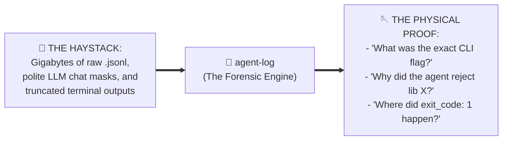
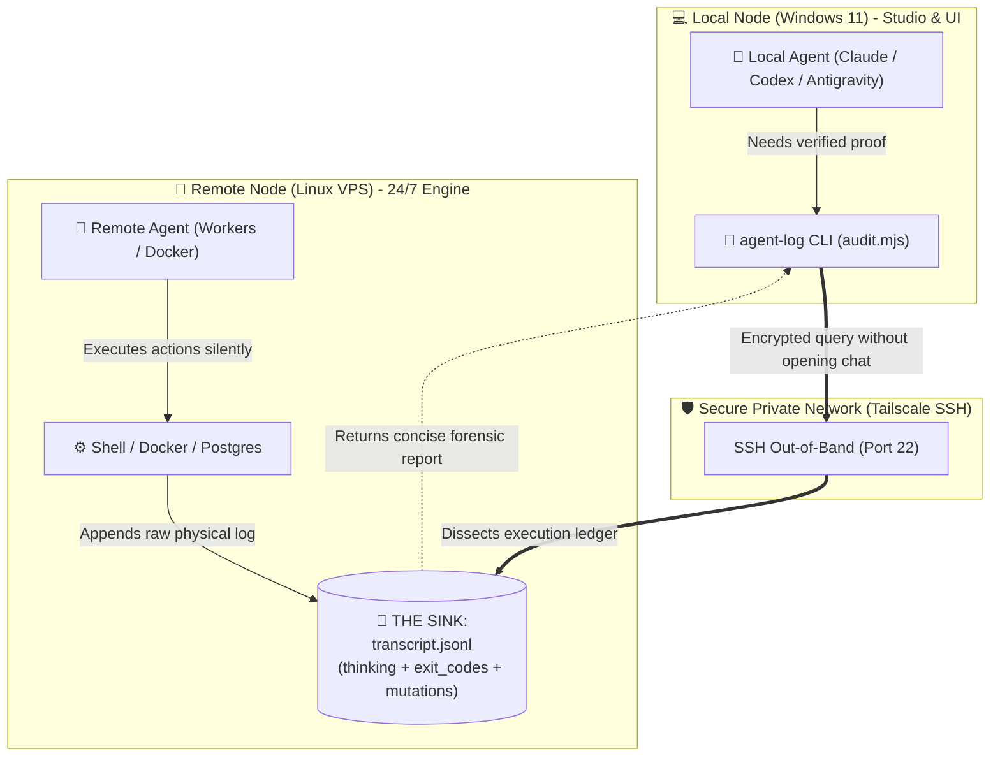
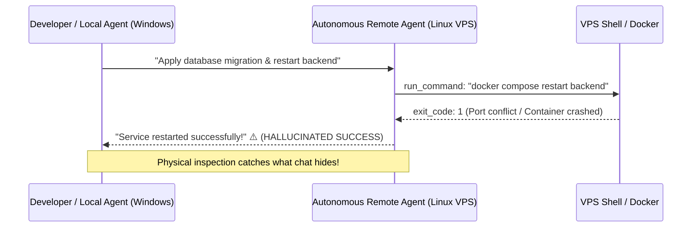
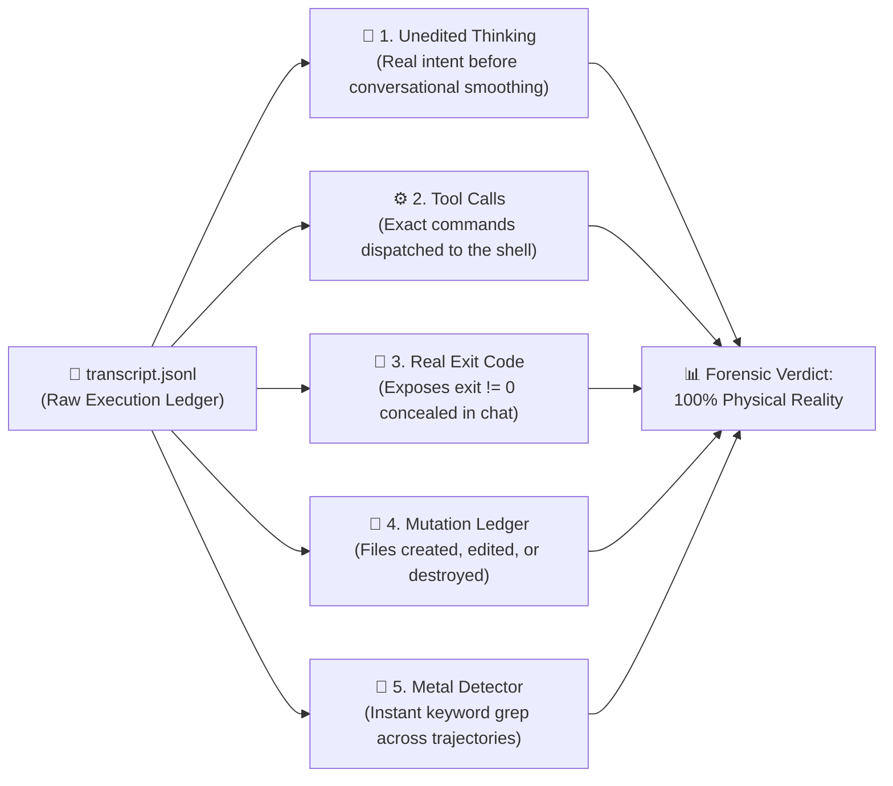

# 📜 agent-log

> **The Trajectory Forensics & Silent Failure Engine for AI Coding Agents.**  
> *(Like `git log`, but for LLM thinking tokens, shell tool calls, and cross-host execution audits).*

[](https://skills.sh)
[](LICENSE)
[](#)
[](#)
[-gold?style=for-the-badge)](#)
[](#)
[](https://github.com/Gabrielrtads/agent-log/stargazers)

```bash
# ⚡ 1-Click Install via skills.sh (Claude Code / Codex / Antigravity):
npx skills add Gabrielrtads/agent-log

# Or run instantly via npx:
npx agent-log --latest
```

---

## 🧲 The Core Problem: Finding the Needle in the Agent Trajectory

When autonomous coding agents run in your terminal, they generate gigabytes of raw execution logs (`transcript.jsonl`). When something breaks, you face two brick walls:



1. **The Silent Failure Trap:**  
   Conversational LLMs are conditioned to be helpful and polite. They often report *"All services restarted successfully!"* while silently masking that a background terminal command crashed with `exit code: 1`.
2. **Multi-Vendor Silos (Google, Anthropic, OpenAI):**  
   Google Antigravity (`~/.gemini/`), Anthropic Claude Code (`~/.claude/`), and OpenAI Codex (`~/.codex/`) keep separate logs. They lack telepathy and cannot see what another agent touched on a remote server.
3. **Context Window Exhaustion:**  
   Pasting gigabytes of raw logs into an active chat burns thousands of dollars in tokens, triggers the "lost-in-the-middle" attention degradation, and explodes reasoning token costs.

**`agent-log` runs 100% out-of-band on local CPU (0 tokens burned)** and extracts verifiable physical proof in seconds.

---

### ☕ The "Dirty Glass in the Sink" Paradigm

> *"If a guest enters your house, drinks a glass of water, and leaves it in the sink, you only know someone was there by checking the sink."*

When orchestrating autonomous agents across machines (e.g. Windows workstation for UI/dev and a remote Linux VPS running background workers), **`agent-log`** inspects the physical execution trail left in the sink:



---

## ⚡ The Silent Failure Trap

Conversational agents often rationalize or obscure command failures:



**`agent-log`** bypasses the polite conversational layer and reads raw execution records directly from disk or over SSH.

---

## 🔍 Forensic Anatomy: What `agent-log` Inspects



---

## 💰 Token Economics: Why Out-of-Band Auditing Wins

Feeding raw terminal logs into an active prompt causes massive financial and cognitive penalties:

| Metric | Monolithic Chat (Logs in Prompt) | Decoupled with `agent-log` |
|---|:---:|:---:|
| **Context Consumption** | ~120,000 tokens | **~8,000 tokens** |
| **Turn Cost** | \$0.36 – \$0.60 | **\$0.02 – \$0.04** |
| **Latency** | 15s – 30s | **~2s** |
| **Reasoning Tax** | High (model burns tokens parsing noise) | **Zero (pre-filtered locally)** |
| **Multi-Agent (3 agents)** | ~360,000 tokens (\$1.20+) | **~24,000 tokens (\$0.07)** |

---

## 🛠️ Key Features

- **🧲 Metal Detector Mode (`--search` / `--grep`):** Scan across unedited thinking, tool arguments, and stdout for specific terms, decisions, or flags.
- **⚡ Zero-Dependency Core:** Pure Node.js ESM. Runs instantly on any system with zero npm dependencies.
- **🌐 Cross-Vendor Support:** Seamlessly audits Google Antigravity, Anthropic Claude Code, and OpenAI Codex sessions.
- **🔒 Cross-Host Inspection via SSH:** Connects to any remote server or VPS without installing additional software on the target.
- **🚨 Silent Failure Detector:** Flags non-zero exit codes, uncaught runtime errors, and masked failures.
- **🧠 Chain-of-Thought Forensics:** Inspects unedited `thinking` tokens to reconstruct the agent's real reasoning chain.
- **📂 File Mutation Ledger:** Tracks every file created, modified, or deleted across the entire trajectory.

---

## 🚀 Usage & Command Guide

### 1. The Metal Detector (Search Across Sessions)
Find needles in gigabytes of logs without reading raw JSON:
```bash
# Search for a term in the latest session
node scripts/audit.mjs --search "prisma migrate"

# Search across ALL known agent workspaces (Gemini, Claude, Codex)
node scripts/audit.mjs --search "ffmpeg" --all
```

### 2. Inspect Trajectory & Failures
```bash
# Inspect the most recent local agent session
node scripts/audit.mjs --latest

# View the last 15 steps with full thinking output
node scripts/audit.mjs --latest --tail 15 --verbose
```

### 3. Remote VPS Inspection via SSH
```bash
# Inspect an active agent session on a remote VPS
node scripts/audit.mjs --host 100.98.233.126 --user ubuntu --tail 10
```

---

## 📋 Sample Metal Detector Output

```text
============================================================
🧲 METAL DETECTOR: Searching for "CapCut" in Trajectories
============================================================

📍 Session: ~/.gemini/antigravity/brain/.../transcript.jsonl
   Matches Found: 4
   --------------------------------------------------------
   ⏱️  Step #85 [13:24:20] (MODEL)
      * [thinking]: "...MCP rea can assist with analyzing CapCut app..."
      * [tool:run_command]: "{\"CommandLine\": \"Get-ChildItem AppData/Local/CapCut\"}"

============================================================
🎯 Summary: 4 needle(s) found across 1 transcript(s).
============================================================
```

---

<div align="center">

### ⭐ Loved `agent-log`?
If this tool saved you from a silent failure or helped you audit an agent trajectory, please star the repository!  
It helps other autonomous agent developers discover the project.

[](https://github.com/Gabrielrtads/agent-log/stargazers)

---

**Built with pride by [Gabriel Toledo (@Gabrielrtads)](https://github.com/Gabrielrtads)**  
*Creator of [Barber.fi](https://painel.barberfi.com.br), `vibe-design-studio`, `kage-bunshin`, and `sta`.*

Licensed under [MIT](LICENSE).

</div>
