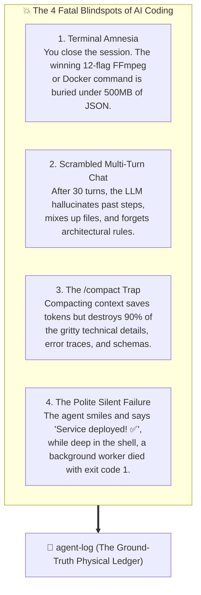
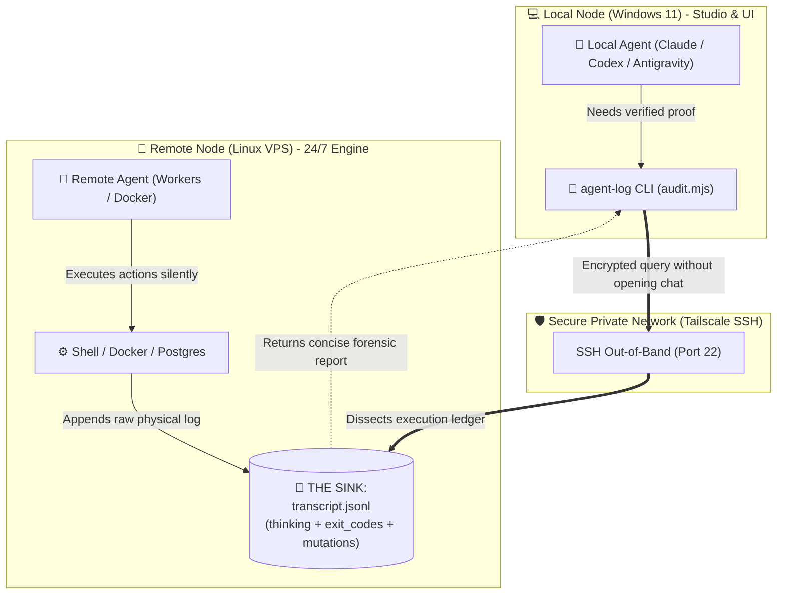

# 📜 agent-log

> **The Trajectory Forensics & Silent Failure Engine for AI Coding Agents.**  
> *(Like `git log`, but for unedited LLM thinking tokens, terminal tool calls, and cross-host execution audits).*

[](https://skills.sh)
[](LICENSE)
[](#)
[](#)
[-gold?style=for-the-badge)](#)
[](#)
[](https://github.com/Gabrielrtads/agent-log/stargazers)

```bash
# ⚡ 1-Click Install via skills.sh (Claude Code / Codex / Antigravity):
npx skills add Gabrielrtads/agent-log

# Or run instantly via npx:
npx agent-log --latest
```

---

## 🩸 The Real Pain: When AI Context Vanishes and Chat Gets Scrambled

If you spend more than a few days vibe-coding with autonomous terminal agents (Claude Code, OpenAI Codex, Google Antigravity, Cursor), you inevitably run into these painful walls:



1. **Terminal Amnesia:**  
   Your agent spent 40 minutes and 15 iterations dialing in a brutally complex one-liner (FFmpeg filter chain, OpenSSL SAN certificate, Prisma migration edge case, or custom sed regex). The moment you close that terminal tab, it vanishes into a black hole.
2. **Scrambled Chats & Conversational Degradation:**  
   As conversational turns pile up, models suffer from context drift. They confuse file paths, contradict decisions made an hour ago, and give polite excuses. You don't need conversational fluff—you need the exact chronological log of what was *physically executed*.
3. **The `/compact` Context Trap:**  
   When sessions get too long, developers run `/compact` to free up tokens. But LLM summarizers throw the baby out with the bathwater: specific API responses, raw error traces, and exact CLI parameters are permanently erased from active memory.
4. **The Polite Silent Failure:**  
   Frontier models are conditioned to be agreeable. They often declare *"Setup finished successfully!"* even when a background script secretly crashed with `exit_code: 1`.

**`agent-log`** bypasses the polite conversational interface completely. It acts as an out-of-band metal detector, reading the physical, unedited `.jsonl` execution ledger directly from disk at **0 token cost**.

---

### ☕ The "Dirty Glass in the Sink" Paradigm

> *"If a guest enters your house, drinks a glass of water, and leaves it in the sink, you don't ask them if they were thirsty. You simply walk into the kitchen and inspect the sink."*

When orchestrating autonomous agents across machines (e.g. your local Windows workstation for UI/dev and a remote Linux VPS running background workers 24/7), **`agent-log`** inspects the physical execution trail left in the sink:



---

## 💡 6 Killer Use Cases (Beyond Just Reading Logs)

Here is where `agent-log` turns into an indispensable superpower for autonomous AI development:

### 1. Decision Archaeology: *"Why the hell is this code here?"*
* **The Scenario:** You find a bizarre `setTimeout(..., 350)` or a custom polyfill inserted into the codebase 4 days ago. If you ask your current AI chat, it will hallucinate a polite guess.
* **The `agent-log` Solution:**
  ```bash
  node scripts/audit.mjs --search "setTimeout" --all --verbose
  ```
  It reveals the agent's **unedited `thinking` token log** from that exact session:  
  `🧠 Thinking: "Electron on Wayland has a known race condition in window creation. Adding 350ms buffer to prevent black frame flicker."`  
  *Zero hallucination. 100% verified ground truth.*

### 2. Ephemeral Parameter & Flag Recovery
* **The Scenario:** The agent created a flawless video rendering pipeline with Remotion or FFmpeg last week, but you forgot the exact codec flags (`-c:v libvpx-vp9 -b:v 2M -pix_fmt yuv420p`).
* **The `agent-log` Solution:**
  ```bash
  node scripts/audit.mjs --search "libvpx-vp9" --all
  ```
  Recovers the exact terminal command in under 1 second without opening huge files or re-running trials.

### 3. Post-Mortem Root Cause Analysis (3 AM Disaster Forensic)
* **The Scenario:** You wake up and Docker containers are crash-looping, or an `.env` file was mysteriously wiped clean.
* **The `agent-log` Solution:**
  ```bash
  node scripts/audit.mjs --host 100.98.233.126 --search "rm -rf"
  # Or check the last 30 actions on the server:
  node scripts/audit.mjs --host 100.98.233.126 --tail 30
  ```
  Identifies the exact step, tool call, timestamp, and command that caused the disaster.

### 4. Zero-Token Selective Decompaction (Anti-Amnésia pós `/compact`)
* **The Scenario:** You had to `/compact` your conversation because context reached 180k tokens. Now you urgently need the exact JSON response payload from a third-party API that was called 2 hours ago.
* **The `agent-log` Solution:**  
  Don't paste 50k tokens back into chat! Run `agent-log --search "webhook/callback"` locally. It reads the raw JSON from disk and feeds only the 5 critical lines back into your prompt. **Cost: 0 tokens.**

### 5. Asynchronous Swarm Handoff (Windows ↔ VPS)
* **The Scenario:** Agent A (Claude Code on Windows) codes features all day. Agent B (Gemini on Linux VPS) wakes up at night to run integration tests and benchmarks.
* **The `agent-log` Solution:**  
  Agent B doesn't ingest Agent A's 80-megabyte conversational chat. It executes:
  ```bash
  node scripts/audit.mjs --host 100.93.1.32 --latest --tail 10
  ```
  In just 200 tokens of verified physical proof, Agent B knows exactly what files were mutated and where Agent A left off.

### 6. "Thinking Token" Audit: Detecting Hallucinated Confidence
* **The Scenario:** Did the model truly understand your architectural invariant, or was it guessing in a hallucination loop?
* **The `agent-log` Solution:**  
  Run `--verbose` to inspect the raw `thinking` stream. You can see when the model felt uncertain, when it was tempted to violate a rule, and why it decided on a specific implementation path.

---

## ⚡ The Silent Failure Trap

Conversational agents often rationalize or obscure command failures:


---

## 💰 Token Economics: Why Out-of-Band Auditing Wins

Feeding raw terminal logs into an active prompt causes massive financial and cognitive penalties:

| Metric | Monolithic Chat (Logs in Prompt) | Decoupled with `agent-log` |
|---|:---:|:---:|
| **Context Consumption** | ~120,000 tokens | **~8,000 tokens** |
| **Turn Cost** | \$0.36 – \$0.60 | **\$0.02 – \$0.04** |
| **Latency** | 15s – 30s | **~2s** |
| **Reasoning Tax** | High (model burns tokens parsing noise) | **Zero (pre-filtered locally)** |
| **Multi-Agent (3 agents)** | ~360,000 tokens (\$1.20+) | **~24,000 tokens (\$0.07)** |

---

## 🛠️ Key Features

- **🧲 Metal Detector Mode (`--search` / `--grep`):** Scan across unedited thinking, tool arguments, and stdout for specific terms, decisions, or flags.
- **⚡ Zero-Dependency Core:** Pure Node.js ESM. Runs instantly on any system with zero npm dependencies.
- **🌐 Cross-Vendor Support:** Seamlessly audits Google Antigravity, Anthropic Claude Code, and OpenAI Codex sessions.
- **🔒 Cross-Host Inspection via SSH:** Connects to any remote server or VPS without installing additional software on the target.
- **🚨 Silent Failure Detector:** Flags non-zero exit codes, uncaught runtime errors, and masked failures.
- **🧠 Chain-of-Thought Forensics:** Inspects unedited `thinking` tokens to reconstruct the agent's real reasoning chain.
- **📂 File Mutation Ledger:** Tracks every file created, modified, or deleted across the entire trajectory.

---

## 🚀 Usage & Command Guide

### 1. The Metal Detector (Search Across Sessions)
Find needles in gigabytes of logs without reading raw JSON:
```bash
# Search for a term in the latest session
node scripts/audit.mjs --search "prisma migrate"

# Search across ALL known agent workspaces (Gemini, Claude, Codex)
node scripts/audit.mjs --search "ffmpeg" --all
```

### 2. Inspect Trajectory & Failures
```bash
# Inspect the most recent local agent session
node scripts/audit.mjs --latest

# View the last 15 steps with full thinking output
node scripts/audit.mjs --latest --tail 15 --verbose
```

### 3. Remote VPS Inspection via SSH
```bash
# Inspect an active agent session on a remote VPS
node scripts/audit.mjs --host 100.98.233.126 --user ubuntu --tail 10
```

---

## 📋 Sample Metal Detector Output

```text
============================================================
🧲 METAL DETECTOR: Searching for "CapCut" in Trajectories
============================================================

📍 Session: ~/.gemini/antigravity/brain/.../transcript.jsonl
   Matches Found: 4
   --------------------------------------------------------
   ⏱️  Step #85 [13:24:20] (MODEL)
      * [thinking]: "...MCP server can assist with analyzing CapCut app..."
      * [tool:run_command]: "{\"CommandLine\": \"Get-ChildItem AppData/Local/CapCut\"}"

============================================================
🎯 Summary: 4 needle(s) found across 1 transcript(s).
============================================================
```

---

<div align="center">

### ⭐ Loved `agent-log`?
If this tool saved you from a silent failure or helped you audit an agent trajectory, please star the repository!  
It helps other autonomous agent developers discover the project.

[](https://github.com/Gabrielrtads/agent-log/stargazers)

---

**Built with pride by [Gabriel Toledo (@Gabrielrtads)](https://github.com/Gabrielrtads)**  
*Creator of [Barber.fi](https://painel.barberfi.com.br), `vibe-design-studio`, `kage-bunshin`, and `sta`.*

Licensed under [MIT](LICENSE).

</div>
