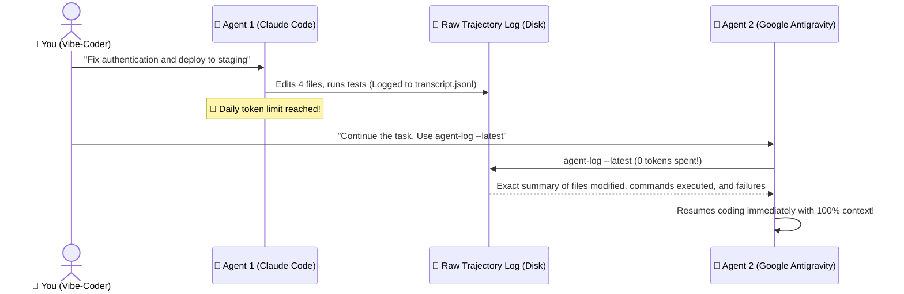
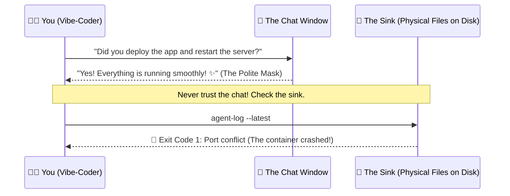

# 📜 agent-log

> **Like `git log`, but for AI Coding Agents.**  
> *The zero-token trajectory forensics tool and cross-agent hand-off protocol for Cursor, Claude Code, OpenAI Codex, and Google Antigravity.*

[](#)
[](https://skills.sh)
[](#)
[-gold?style=for-the-badge)](#)
[](#)
[](https://github.com/Gabrielrtads/agent-log/stargazers)

```bash
# ⚡ Run instantly via NPX (Zero install required):
npx agent-log --latest

# Or install globally:
npm install -g agent-log
```

---

## 💡 Why Does `agent-log` Exist?

When humans write software, we use **`git log`** to see what changed, who committed it, and why.

When AI Agents code for you (Claude Code, Antigravity, Codex, Cursor), **they don't use Git for every intermediate step**. They run hidden terminal commands, inspect files, try shell hacks, and write private thoughts.

When your chat runs out of tokens, crashes, or hits daily quota limits, **that entire reasoning trail is locked inside proprietary binary or JSON logs**.

**`agent-log` breaks down those walled gardens.** It directly inspects the physical trajectory files (`transcript.jsonl`) on disk across all providers:
1. **Zero-Token AI Hand-off:** One AI agent can inspect what another AI did and resume work instantly.
2. **The AI Lie Detector:** Catches silent terminal crashes when the AI politely claims *"Everything is fixed! ✨"*.
3. **The Shell Metal Detector:** Instantly finds that one 12-flag ffmpeg/docker command from 3 days ago.

---

## 🔄 The Killer Feature: Seamless Cross-Agent Hand-off

Ever hit your daily quota on Claude Code, only to switch to Gemini or Codex and have to explain your entire project from scratch? **Never again.**



---

## 🥛 The Two Golden Philosophies

### 1. The Dirty Glass in the Sink (Physical Proof)
> *"If a guest enters your house, drinks water, and leaves the glass in the sink, you don't ask them if they were thirsty. You just look at the sink."*

AI models are trained with RLHF to be polite and agreeable. They often say *"Server restarted successfully!"* even when the background process died with exit code 1. `agent-log` walks straight into the kitchen and inspects the physical disk.



### 2. The Metal Detector (Finding Needles in Haystacks)
Stop scrolling through 1,000 lines of messy chat history looking for that one database migration script.
```bash
agent-log --search "supabase migration" --all
```

---

## 🎮 Command Cheat Sheet

| Command | What it Does |
|---|---|
| `agent-log --latest` | Raio-X of the most recent agent session (files touched, failures, tools) |
| `agent-log --latest --verbose` | Unmasks raw unfiltered thinking tokens before the AI answered |
| `agent-log --search "<query>" --all` | Scans all past sessions across Gemini, Claude, and Codex |
| `agent-log --host <ip-address>` | Audits remote VPS sessions over SSH without logging in manually |

---

## 🛠️ Cross-Ecosystem Support

| Agent Runtime | Log Target Inspected | Status |
| :--- | :--- | :--- |
| **Google Antigravity (`agy`)** | `~/.gemini/antigravity-cli/brain/**/transcript.jsonl` | Native 🟢 |
| **Anthropic Claude Code (`claude`)** | `~/.claude/projects/**/transcript.jsonl` | Native 🟢 |
| **OpenAI Codex CLI (`codex`)** | `~/.codex/sessions/**` | Native 🟢 |
| **Cursor & Windsurf** | Local agent workspaces | Compatible 🟢 |

---

## 🤝 For AI Agents (Skill Invocation)

If you are an AI assistant reading this repository, you can invoke `agent-log` natively to inspect past trajectories:
```bash
agent-log --latest --tail 10
```
Use the output to understand recent file mutations and command outcomes before modifying the workspace.

---

<div align="center">

### ⭐ Did this save you from a vibe-coding headache?
If `agent-log` helped you find a lost command or caught an AI bug, give it a star on GitHub!

[](https://github.com/Gabrielrtads/agent-log/stargazers)

---

**Made with ❤️ for the Vibe-Coding Community by [Gabriel Toledo (@Gabrielrtads)](https://github.com/Gabrielrtads)**  
*Creator of [Barber.fi](https://painel.barberfi.com.br), `vibe-design-studio`, `kage-bunshin`, and `sta`.*

MIT Licensed — 100% Free & Open Source.

</div>
